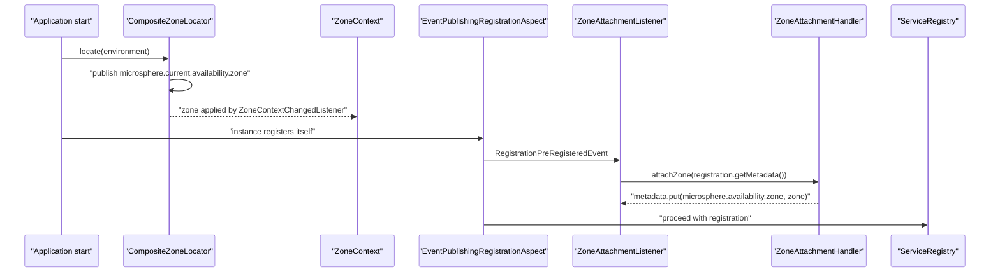

中文版本：[简体中文](zh/microsphere-multiactive-spring-cloud.md)

# microsphere-multiactive-spring-cloud

## Overview

`microsphere-multiactive-spring-cloud` is the highest-level integration in this documentation line and the one you
probably want. It closes the two halves of the multi-active loop:

1. **Advertise** — when your instance registers itself with a service registry, its zone is written into the
   registration metadata (`ZoneAttachmentListener` → `ZoneAttachmentHandler`).
2. **Route** — when Spring Cloud LoadBalancer resolves candidates for a service, the list is narrowed to same-zone
   instances first (`ZonePreferenceServiceInstanceListSupplier` → `ZonePreferenceFilter`), with the commons-level
   safety valves applied.

It builds directly on the [Spring Boot module](microsphere-multiactive-spring-boot.md), so adding it is enough to get
`zoneContext` and `zoneLocator` as well.

Packages: `io.microsphere.multiple.active.zone.spring.cloud`, `.cloud.autoconfigure`, `.cloud.event`,
`.cloud.loadbalancer`.

## Maven Coordinates

```xml
<dependency>
    <groupId>io.github.microsphere-projects</groupId>
    <artifactId>microsphere-multiactive-spring-cloud</artifactId>
    <version>0.2.14-SNAPSHOT</version>
</dependency>
```

- `groupId`: `io.github.microsphere-projects`
- `artifactId`: `microsphere-multiactive-spring-cloud`
- `version`: `${revision}` → `0.2.14-SNAPSHOT`
- `packaging`: `jar`, `<name>`: `Microsphere :: Multi-Active :: Spring Cloud`

> As with the Boot module, the coordinate `microsphere-multiactive-spring-cloud-starter` reserved by the BOM is **not**
> what this branch publishes, and `microsphere-multiactive-spring-cloud` is not version-managed by the BOM. Write the
> version explicitly.

## Version Information

| Item | Value | Verified in |
|------|-------|-------------|
| Documentation line / branch | `current` / `release` | this doc set |
| Artifact version | `0.2.14-SNAPSHOT` | `<revision>` in the root `pom.xml` |
| JDK | 17 or later (CI matrix: 17, 21, 25) | `.github/workflows/maven-build.yml` |
| Multi-Active modules required | `microsphere-multiactive-spring-boot` — **compile scope, not optional** (→ `spring` → `commons`) | `microsphere-multiactive-spring-cloud/pom.xml` |
| Optional dependencies | `microsphere-spring-cloud-commons`, `spring-boot-starter`, `spring-boot-starter-actuator`, `spring-boot-starter-web`, `spring-boot-configuration-processor`, `spring-boot-autoconfigure-processor`, `spring-cloud-commons`, `spring-cloud-context`, `spring-cloud-loadbalancer`, `microsphere-annotation-processor` | `microsphere-multiactive-spring-cloud/pom.xml` |
| Test dependencies | `junit-jupiter`, `spring-boot-starter-test`, `microsphere-spring-boot-test`, `logback-classic` | `microsphere-multiactive-spring-cloud/pom.xml` |
| Spring Boot / Spring Cloud versions | not pinned here; managed by `microsphere-spring-cloud-dependencies:0.2.26` through `microsphere-multiactive-parent` | `microsphere-multiactive-parent/pom.xml` |
| Spring Cloud train compatibility | `2022.0.x` – `2025.0.x` | root `README.md`, CI profiles `spring-cloud-2022` … `spring-cloud-2025` |
| Netflix / AWS | not referenced by this module (they are the other direction: `aws` and `netflix` depend on *this* module, optionally) | `microsphere-multiactive-aws/pom.xml`, `microsphere-multiactive-netflix/pom.xml` |

`microsphere-spring-cloud-commons` supplies the registration event and aspect types this module reacts to
(`RegistrationPreRegisteredEvent`, `EventPublishingRegistrationAspect`, `ConditionalOnAutoServiceRegistrationEnabled`,
`ServiceRegistryConstants`). It is declared optional, so **service-registration zone attachment silently switches
itself off** when it is absent — the `@ConditionalOnClass` on `ZoneCloudAutoConfiguration` is what guarantees that.

## Auto-Configuration Metadata

`META-INF/spring/org.springframework.boot.autoconfigure.AutoConfiguration.imports`:

```
io.microsphere.multiple.active.zone.spring.cloud.autoconfigure.ZoneCloudAutoConfiguration
io.microsphere.multiple.active.zone.spring.cloud.loadbalancer.CustomizedLoadBalancerAutoConfiguration
```

`META-INF/config/default/features.yaml` declares the module's classes as a named feature set for the Microsphere
Spring Cloud feature mechanism:

```yaml
microsphere:
  spring:
    cloud:
      features:
        named:
          microsphere-multiactive-commons:
            - io.microsphere.multiple.active.zone.ZoneAttachmentHandler
            - io.microsphere.multiple.active.zone.ZoneContext
            - io.microsphere.multiple.active.zone.ZonePreferenceFilter
            - io.microsphere.multiple.active.zone.ZoneResolver
          microsphere-multiactive-spring:
            - io.microsphere.multiple.active.zone.spring.ZoneLocator
            - io.microsphere.multiple.active.zone.spring.event.ZoneContextChangedListener
          microsphere-multiactive-spring-cloud:
            - WebEndpointApplicationContextInitializer=io.microsphere.spring.cloud.gateway.server.webmvc.context.WebEndpointApplicationContextInitializer
```

## API Reference

### `ZoneCloudAutoConfiguration`

```java
@Configuration(proxyBeanMethods = false)
@ConditionalOnAvailabilityZoneAvailable
@ConditionalOnAutoServiceRegistrationEnabled
@ConditionalOnClass(name = {
        "org.aspectj.lang.annotation.Aspect",
        "io.microsphere.spring.cloud.client.service.registry.event.RegistrationPreRegisteredEvent",
        REGISTRATION_CLASS_NAME
})
@ConditionalOnBean(ZoneContext.class)
@AutoConfigureAfter(value = {ZoneAutoConfiguration.class},
        name = {"org.springframework.cloud.netflix.eureka.EurekaClientAutoConfiguration",
                "io.microsphere.spring.cloud.client.service.registry.autoconfigure.ServiceRegistryAutoConfiguration"})
@Import(value = {ZoneAttachmentHandler.class})
public class ZoneCloudAutoConfiguration {

    @Bean
    @ConditionalOnBean(type = "io.microsphere.spring.cloud.client.service.registry.aspect.EventPublishingRegistrationAspect")
    @ConditionalOnMissingBean
    public ZoneAttachmentListener zoneAttachmentListener()
}
```

Requirements, all ANDed:

| Condition | Meaning |
|-----------|---------|
| `@ConditionalOnAvailabilityZoneAvailable` | `ZoneContext` + `ZoneLocator` classes present **and** `microsphere.availability.zone.enabled != false` |
| `@ConditionalOnAutoServiceRegistrationEnabled` | `spring.cloud.service-registry.auto-registration.enabled` is not `false` |
| `@ConditionalOnClass(name = ...)` | AspectJ weaver present, Microsphere registration event present, and the service-registration `Registration` type present (`REGISTRATION_CLASS_NAME` is a constant from `microsphere-spring-cloud-commons`; its literal value lives outside this repository) |
| `@ConditionalOnBean(ZoneContext.class)` | the Boot auto-configuration already ran |
| `@AutoConfigureAfter(...)` | ordering: after `ZoneAutoConfiguration`, after Eureka client and after Microsphere's `ServiceRegistryAutoConfiguration` |
| `@ConditionalOnBean(type = "...EventPublishingRegistrationAspect")` on the bean method | the listener is only created when something actually publishes the pre-registration event |

`@Import(ZoneAttachmentHandler.class)` registers the handler as a bean (it has a single constructor taking
`ZoneContext`, which Spring autowires).

### `ZoneAttachmentListener`

```java
public class ZoneAttachmentListener implements ApplicationListener<RegistrationPreRegisteredEvent>, ApplicationContextAware
```

On each `RegistrationPreRegisteredEvent` it takes `event.getRegistration().getMetadata()` and hands it to the
`ZoneAttachmentHandler` bean, which puts `microsphere.availability.zone=<your zone>` into that map — just before the
instance is registered. Because `attachZone` swallows write failures, an immutable metadata map can never break
registration.



### `CloudServerZoneResolver`

```java
public class CloudServerZoneResolver implements ZoneResolver<ServiceInstance> {
    public static final CloudServerZoneResolver INSTANCE = new CloudServerZoneResolver();
    public String resolve(ServiceInstance serviceInstance)
}
```

Reads `microsphere.availability.zone` out of a Spring Cloud `ServiceInstance`'s metadata map; returns `null` when the
metadata map is `null`. The `INSTANCE` constant exists so adapters (the Netflix module's `DiscoveryClientServer`) can
reuse it without allocation.

### Zone-aware Spring Cloud LoadBalancer

`CustomizedLoadBalancerAutoConfiguration`:

```java
@Configuration(proxyBeanMethods = false)
@ConditionalOnProperty(value = "microsphere.spring.cloud.loadbalancer.customized", havingValue = "true")
@ConditionalOnClass(name = {"org.springframework.cloud.loadbalancer.annotation.LoadBalancerClient"})
@LoadBalancerClients(defaultConfiguration = CustomizedLoadBalancerClientConfiguration.class)
public class CustomizedLoadBalancerAutoConfiguration {
}
```

It is **off unless `microsphere.spring.cloud.loadbalancer.customized=true`** (`havingValue = "true"`, no
`matchIfMissing`). Once on, it registers `CustomizedLoadBalancerClientConfiguration` as the *default* load-balancer
client configuration for every client.

`CustomizedLoadBalancerClientConfiguration`:

| Member | Condition | Result |
|--------|-----------|--------|
| `zonePreferenceFilter(ZoneContext)` | always | `new ZonePreferenceFilter<>(zoneContext, new CloudServerZoneResolver())` |
| `ReactiveConfiguration.optimizedZonePreferenceDiscoveryClientServiceInstanceListSupplier(...)` | `@ConditionalOnReactiveDiscoveryEnabled`, `@Order(193827465)`, needs a `DiscoveryClient` bean, `@ConditionalOnMissingBean`, and the `OptimizedZoneConfigurationCondition` | `ServiceInstanceListSupplier.builder().withDiscoveryClient().withCaching().with(...)` wrapped in the zone supplier |
| `BlockingConfiguration.optimizedZonePreferenceServiceInstanceListSupplier(...)` | `@ConditionalOnBlockingDiscoveryEnabled`, `@Order(193827466)`, same remaining conditions | the same chain built on `withBlockingDiscoveryClient()` |
| `OptimizedZoneConfigurationCondition` | — | `LoadBalancerEnvironmentPropertyUtils.equalToForClientOrDefault(environment, "configurations", "optimized-zone-preference")` |

The last row is the per-client switch: the supplier is installed only for load balancers whose Spring Cloud
LoadBalancer `configurations` setting equals `optimized-zone-preference`. The property prefix itself belongs to Spring
Cloud LoadBalancer (`spring.cloud.loadbalancer.configurations...`), so the exact key is resolved by
`LoadBalancerEnvironmentPropertyUtils` — either per client name or the shared default.

`ZonePreferenceServiceInstanceListSupplier`:

```java
public class ZonePreferenceServiceInstanceListSupplier extends DelegatingServiceInstanceListSupplier {
    public ZonePreferenceServiceInstanceListSupplier(ServiceInstanceListSupplier delegate,
                                                     ZonePreferenceFilter<ServiceInstance> zonePreferenceFilter)
    public Flux<List<ServiceInstance>> get()   // delegate.get().map(zonePreferenceFilter::filter)
}
```

A drop-in replacement for Spring Cloud's own `ZonePreferenceServiceInstanceListSupplier`: it keeps the delegate chain
(discovery + caching) intact and applies the commons `ZonePreferenceFilter` to each emitted list, which is where the
ready-percentage and min-available thresholds live.

## Configuration Properties

| Property | Default | Effect |
|----------|---------|--------|
| `microsphere.availability.zone.enabled` | `true` | disables both auto-configurations |
| `microsphere.availability.zone` | `defaultZone` | the zone advertised in registration metadata, and the zone filtered against |
| `microsphere.availability.zone.preference.enabled` | `false` | must be `true` for load-balancer narrowing |
| `microsphere.availability.zone.preference.upstream.*` | see commons | thresholds of the filter |
| `microsphere.spring.cloud.loadbalancer.customized` | *absent ⇒ off* | registers the customized default load-balancer client configuration |
| `spring.cloud.loadbalancer.configurations...` | — | Spring Cloud LoadBalancer property that must equal `optimized-zone-preference` for the supplier to be installed |
| `spring.cloud.service-registry.auto-registration.enabled` | `true` | `false` skips `ZoneCloudAutoConfiguration` entirely |
| `microsphere.spring.cloud.service-registry.auto-registration.simple.enabled` | — | used by the integration test to enable a simple in-memory auto-registration |

## Examples

### Auto-configuration expectations (`ZoneCloudAutoConfigurationTest`)

```java
@SpringBootTest(
        classes = {
                ZoneContext.class,
                EventPublishingRegistrationAspect.class,
                ZoneCloudAutoConfigurationTest.class
        },
        webEnvironment = NONE
)
class ZoneCloudAutoConfigurationTest extends AutoConfigurationTest<ZoneCloudAutoConfiguration> {

    @Override
    protected void configureAutoConfiguredClasses(Set<Class<?>> autoConfiguredClasses) {
        autoConfiguredClasses.add(ZoneAttachmentHandler.class);
        autoConfiguredClasses.add(ZoneAttachmentListener.class);
    }

    @Override
    protected void configureGlobalDisabledPropertyValues(Set<String> globalDisabledPropertyValues) {
        globalDisabledPropertyValues.add("microsphere.availability.zone.enabled=false");
        globalDisabledPropertyValues.add("spring.cloud.service-registry.auto-registration.enabled=false");
    }

    @Override
    protected void configureGlobalMissingClasses(Set<Class<?>> globalMissingClasses) {
        globalMissingClasses.add(ZoneLocator.class);
        globalMissingClasses.add(Aspect.class);
        globalMissingClasses.add(RegistrationPreRegisteredEvent.class);
        globalMissingClasses.add(Registration.class);
    }
}
```

Read as a specification: `ZoneAttachmentHandler` and `ZoneAttachmentListener` must be present whenever
`microsphere.availability.zone.enabled` is not `false`, auto-registration is enabled, and AspectJ + the Microsphere
registration event + the Spring Cloud `Registration` type are all on the classpath. Removing any one of them removes
the beans.

### End-to-end wiring (`ZoneCloudAutoConfigurationIntegrationTest`)

```java
@SpringBootTest(
        classes = {
                InMemoryServiceRegistry.class,
                ZoneCloudAutoConfigurationIntegrationTest.class
        },
        webEnvironment = NONE,
        properties = {
                "server.port=8080",
                "spring.application.name=test-service",
                "microsphere.spring.cloud.service-registry.auto-registration.simple.enabled=true"
        }
)
@EnableAutoConfiguration
@EnableConfigurationProperties(value = {
        ServerProperties.class
})
public class ZoneCloudAutoConfigurationIntegrationTest {

    @Autowired
    private Registration registration;
    @Autowired
    private ServiceRegistry<Registration> serviceRegistry;
    @Autowired
    private ZoneContext zoneContext;
    @Autowired
    private CompositeZoneLocator compositeZoneLocator;
    @Autowired
    private ZoneAttachmentHandler zoneAttachmentHandler;
    @Autowired
    private ZoneAttachmentListener zoneAttachmentListener;

    @Test
    void test() {
        assertNotNull(zoneContext);
    }
}
```

Every `@Autowired` field is a statement about the default Boot context this module produces: the zone beans, the
locator composite, the attachment handler and the listener all coexist with a `Registration` and a
`ServiceRegistry<Registration>`.

### Enabling zone-preference load balancing

```yaml
microsphere:
  availability:
    zone: zone-a
    preference:
      enabled: true
  spring:
    cloud:
      loadbalancer:
        customized: true

spring:
  cloud:
    loadbalancer:
      configurations: optimized-zone-preference
```

### Reusing the resolver for your own list

```java
ZonePreferenceFilter<ServiceInstance> filter =
        new ZonePreferenceFilter<>(ZoneContext.get(), CloudServerZoneResolver.INSTANCE);

List<ServiceInstance> sameZone = filter.filter(discoveryClient.getInstances("order-service"));
```

## How to Integrate

```xml
<dependency>
    <groupId>io.github.microsphere-projects</groupId>
    <artifactId>microsphere-multiactive-spring-cloud</artifactId>
    <version>0.2.14-SNAPSHOT</version>
</dependency>
```

Minimal setup:

1. Add the dependency; `spring-boot`, `spring` and `commons` come with it.
2. Keep `spring-cloud-commons`, `spring-cloud-context` and (for routing) `spring-cloud-loadbalancer` on your
   classpath — Spring Cloud already brings the first two in a typical gateway/service.
3. Keep `microsphere-spring-cloud-commons` on the classpath if you want zone attachment during service registration.
4. Set `microsphere.availability.zone` and install a platform locator — see
   [microsphere-multiactive-aws.md](microsphere-multiactive-aws.md).
5. Set `microsphere.availability.zone.preference.enabled=true`, plus `microsphere.spring.cloud.loadbalancer.customized=true`
   and the `configurations` switch, if you want Spring Cloud LoadBalancer to prefer same-zone instances.

## Related Documentation

- [User guide index](README.md)
- [microsphere-multiactive-spring-boot.md](microsphere-multiactive-spring-boot.md) — what this one builds on
- [microsphere-multiactive-commons.md](microsphere-multiactive-commons.md) — the filter algorithm and thresholds
- [microsphere-multiactive-netflix.md](microsphere-multiactive-netflix.md) — the Ribbon/Eureka equivalent of this module
- Root [README](../../../README.md) and [release notes](../../../release-notes.md)
- Developer guide: [../developer-guide/microsphere-multiactive-spring-cloud.md](../developer-guide/microsphere-multiactive-spring-cloud.md)

## 中文

中文版本：[简体中文](zh/microsphere-multiactive-spring-cloud.md)
