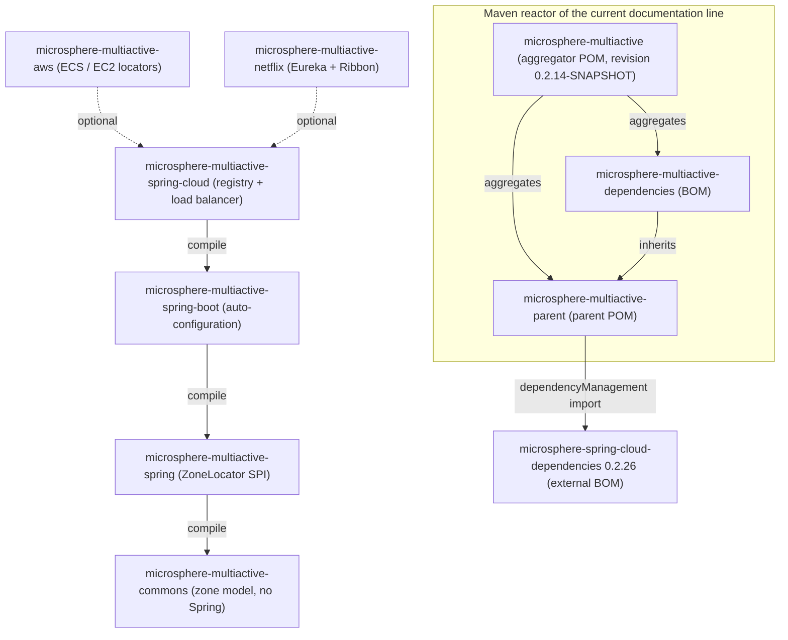

English version: [English](../README.md)

# Microsphere Multiactive 用户指南（`current`）

本指南属于 **`current`** 文档线，对应 `microsphere-multiactive` 的 **`release`** 分支。Microsphere Multiactive
是一个多活 / 可用区（zone）感知的容错库：它发现当前进程所处的可用区，把该可用区写入服务注册元数据，并在路由下游实例时
优先选择同区实例，同时保留跨区兜底能力。

本套文档中的每一条结论都来自本文档线的源码：POM 文件、`src/main/java`、`src/main/resources/META-INF` 以及
`src/test/java`。快照中不存在的 API 一律没有写入文档。

## 版本速览

| 项目 | 值 | 定义位置 |
|------|-------|---------------------|
| Git 分支 | `release` | 文档线 `current` |
| 构件版本 | `0.2.14-SNAPSHOT` | 根 [`pom.xml`](../../../../pom.xml) 的 `<revision>` 属性 |
| 本条线最近一次发布 | `0.2.13` | [`release-notes.md`](../../../../release-notes.md) |
| 所有模块的 groupId | `io.github.microsphere-projects` | 各模块 POM |
| JDK | 17 及以上；CI 在 JDK 17、21、25 上编译与测试 | `.github/workflows/maven-build.yml`、`.github/workflows/maven-publish.yml` |
| Maven | Apache Maven 3.9.16（Maven wrapper 发行版） | `.mvn/wrapper/maven-wrapper.properties` |
| Spring Cloud 兼容范围 | `2022.0.x` – `2025.0.x`（CI profile `spring-cloud-2022` … `spring-cloud-2025`） | 根 [`README.md`](../../../../README.md)、`.github/workflows/maven-build.yml` |
| Spring Boot 版本 | 本仓库未声明；由 `microsphere-spring-cloud-dependencies:0.2.26` 继承而来 | `microsphere-multiactive-parent/pom.xml` |

## 目录

| 文档 | 模块 | 一句话说明 |
|----------|--------|----------------------|
| [microsphere-multiactive-parent.md](microsphere-multiactive-parent.md) | `microsphere-multiactive-parent` | 所有模块继承的父 POM：`${revision}` 版本管理与受管 `microsphere-spring-cloud-dependencies` 导入 |
| [microsphere-multiactive-dependencies.md](microsphere-multiactive-dependencies.md) | `microsphere-multiactive-dependencies` | 锁定全部 Multi-Active 构件版本的 BOM |
| [microsphere-multiactive-commons.md](microsphere-multiactive-commons.md) | `microsphere-multiactive-commons` | 不依赖框架的可用区模型：`ZoneContext`、`ZoneConstants`、`ZoneResolver`、`ZonePreferenceFilter`、`ZoneAttachmentHandler`、`HttpUtils` |
| [microsphere-multiactive-spring.md](microsphere-multiactive-spring.md) | `microsphere-multiactive-spring` | `ZoneLocator` SPI 及 `DefaultZoneLocator`、`CompositeZoneLocator`、`ZoneUtils` 与可用区 Spring 事件 |
| [microsphere-multiactive-spring-boot.md](microsphere-multiactive-spring-boot.md) | `microsphere-multiactive-spring-boot` | Spring Boot 自动配置（`ZoneAutoConfiguration`）与可用区条件注解 |
| [microsphere-multiactive-spring-cloud.md](microsphere-multiactive-spring-cloud.md) | `microsphere-multiactive-spring-cloud` | 可用区写入服务注册，以及可用区感知的 Spring Cloud LoadBalancer 支持 |
| [microsphere-multiactive-aws.md](microsphere-multiactive-aws.md) | `microsphere-multiactive-aws` | 面向 ECS 容器元数据文件、ECS 任务元数据端点 v4 与 EC2 可用区端点的可用区定位器 |
| [microsphere-multiactive-netflix.md](microsphere-multiactive-netflix.md) | `microsphere-multiactive-netflix` | Netflix OSS 集成：Eureka 元数据解析器、Ribbon `ServerListFilter` 以及基于 DiscoveryClient 的 Ribbon `ServerList` |

## 模块关系



实线箭头表示各模块 `pom.xml` 中声明的必需（compile 作用域）依赖；虚线箭头表示 `<optional>true</optional>`
依赖。`aws` 与 `netflix` 声明了对 `microsphere-multiactive-spring-cloud` 的可选依赖，并借此间接获得
`spring-boot`、`spring` 与 `commons`。

## 快速开始

最省事的做法是导入 BOM，然后添加你所需要的最高层模块（Spring Cloud 模块）：

```xml
<dependencyManagement>
    <dependencies>
        <dependency>
            <groupId>io.github.microsphere-projects</groupId>
            <artifactId>microsphere-multiactive-dependencies</artifactId>
            <version>0.2.14-SNAPSHOT</version>
            <type>pom</type>
            <scope>import</scope>
        </dependency>
    </dependencies>
</dependencyManagement>

<dependencies>
    <dependency>
        <groupId>io.github.microsphere-projects</groupId>
        <artifactId>microsphere-multiactive-spring-cloud</artifactId>
        <version>0.2.14-SNAPSHOT</version>
    </dependency>
</dependencies>
```

若使用正式发布版本，请把 `0.2.14-SNAPSHOT` 替换为本条线的已发布版本（例如 `0.2.13`）。
在本文档线上，`microsphere-multiactive-spring-cloud` 必须显式写出版本：BOM 只锁定了 `commons`、`spring`、`aws`
与 `netflix`，并未覆盖本分支构建出的 Spring Boot / Spring Cloud 构件 —— 详见
[microsphere-multiactive-dependencies.md](microsphere-multiactive-dependencies.md)。

## 配置项速查

所有属性名都声明为 `ZoneConstants`（位于 `microsphere-multiactive-commons`）中的常量，并由 `ZoneConstantsTest` 断言：

| 属性键 | 默认值 | 用途 |
|--------------|---------|---------|
| `microsphere.availability.zone` | `defaultZone` | 当前应用的可用区 |
| `microsphere.current.availability.zone` | `defaultZone` | 由 `CompositeZoneLocator` 写入的 JVM 系统属性 |
| `microsphere.availability.zone.enabled` | `true` | 整个功能的总开关 |
| `microsphere.availability.zone.preference.enabled` | `false` | 开启同区优先过滤 |
| `microsphere.availability.zone.preference.filter.order` | `10` | `ZonePreferenceFilter.getOrder()` 返回的顺序值 |
| `microsphere.availability.zone.preference.upstream.zone-ready-percentage` | `100` | 上游节点中必须携带可用区的最小百分比 |
| `microsphere.availability.zone.preference.upstream.same-zone-min-available` | `5` | 启用同区优先所需的最小同区节点数 |
| `microsphere.availability.zone.preference.upstream.disabled-zone` | *无* | 逗号分隔、始终被排除的可用区 |
| `microsphere.availability.zone.locator.fast-fail` | `false` | 当支持的定位器无法定位可用区时快速失败 |
| `microsphere.availability.zone.locator.timeout` | `3000` | AWS 元数据定位器的连接/读取超时（毫秒） |

## 相关文档

- 根 [README](../../../../README.md) —— 项目概览、徽章、JavaDoc 链接。
- [发布说明](../../../../release-notes.md) —— 本条线各版本的变更历史。
- 开发者指南 —— 模块内部设计与约定：
  [索引](../../developer-guide/zh/README.md)、
  [commons](../../developer-guide/zh/microsphere-multiactive-commons.md)、
  [spring](../../developer-guide/zh/microsphere-multiactive-spring.md)、
  [spring-boot](../../developer-guide/zh/microsphere-multiactive-spring-boot.md)、
  [spring-cloud](../../developer-guide/zh/microsphere-multiactive-spring-cloud.md)、
  [aws](../../developer-guide/zh/microsphere-multiactive-aws.md)、
  [netflix](../../developer-guide/zh/microsphere-multiactive-netflix.md)。

## English

English version: [English](../README.md)
