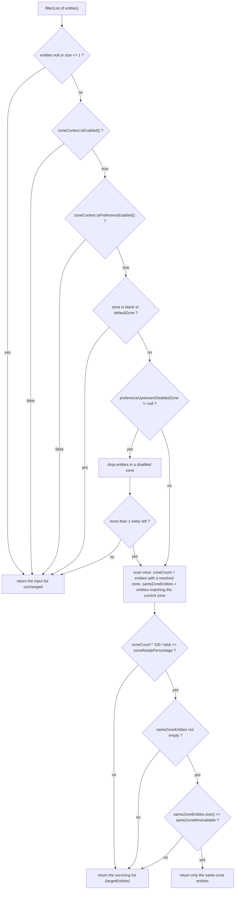

English version: [English](../microsphere-multiactive-commons.md)

# microsphere-multiactive-commons

## 概述

`microsphere-multiactive-commons` 是整个项目的框架无关核心。它包含了完整的可用区（zone）模型，而不含任何集成部分：
没有 Spring、没有 Servlet API、没有 discovery client。凡是关于可用区能够被决定的事情都在这里决定，从而让上层模块
（`spring`、`spring-boot`、`spring-cloud`、`aws`、`netflix`）保持为薄薄的适配器。

它回答三个问题：

1. **我在哪个可用区？** —— `ZoneContext` 保存答案，`ZoneConstants` 定义答案来自哪些 key。
2. **我该不该调用这个下游节点？** —— `ZonePreferenceFilter` 把候选实体列表收敛为同区子集，并带有明确的兜底安全阀，
   避免“注册信息不完整的一个区”演变成整体不可用。
3. **我如何把自己的区告诉别人？** —— `ZoneAttachmentHandler` 把可用区写入注册元数据，`ZoneResolver`
   则从任意实体类型中把它读回来。

包名：`io.microsphere.multiple.active.zone`。类的 Javadoc 标注 `@since 1.0.0`。

## Maven 坐标

```xml
<dependency>
    <groupId>io.github.microsphere-projects</groupId>
    <artifactId>microsphere-multiactive-commons</artifactId>
    <version>0.2.14-SNAPSHOT</version>
</dependency>
```

- `groupId`：`io.github.microsphere-projects`
- `artifactId`：`microsphere-multiactive-commons`
- `version`：`${revision}` → `0.2.14-SNAPSHOT`
- `packaging`：`jar`，`<name>`：`Microsphere :: Multi-Active :: Commons`
- 版本由 [microsphere-multiactive-dependencies](microsphere-multiactive-dependencies.md) 管理，导入 BOM 后可以省略
  `<version>` 元素。

## 版本信息

| 项目 | 值 | 验证位置 |
|------|-------|-------------|
| 文档线 / 分支 | `current` / `release` | 本套文档 |
| 构件版本 | `0.2.14-SNAPSHOT` | 根 `pom.xml` 的 `<revision>` |
| JDK | 17 及以上（CI 矩阵：17、21、25） | `.github/workflows/maven-build.yml` |
| 依赖的其他 Multi-Active 模块 | **无** —— 本模块是依赖图的叶子 | `microsphere-multiactive-commons/pom.xml` |
| 编译依赖 | `io.github.microsphere-projects:microsphere-annotation-processor`（可选）、`io.github.microsphere-projects:microsphere-java-core`（可选） | `microsphere-multiactive-commons/pom.xml` |
| 测试依赖 | `org.junit.jupiter:junit-jupiter`、`io.github.microsphere-projects:microsphere-java-test`、`ch.qos.logback:logback-classic` | `microsphere-multiactive-commons/pom.xml` |
| Spring / Spring Boot / Netflix / AWS | 本模块完全不引用 | `src/main/java` 源码 |

**可选依赖的注意事项。** `microsphere-java-core` 被声明为 `<optional>true</optional>`，但代码从中 import 了
`io.microsphere.logging.Logger`、`io.microsphere.logging.LoggerFactory`、`io.microsphere.util.StringUtils`、
`io.microsphere.constants.SymbolConstants`、`io.microsphere.constants.PropertyConstants` 与
`io.microsphere.io.IOUtils`。可选依赖**不会**传递，因此只依赖 `commons` 的应用必须自己加入
`microsphere-java-core`（任何 Multi-Active Spring 模块都会带上自身需要的部分；而注解处理器
`microsphere-annotation-processor` 提供 `io.microsphere.annotation.ConfigurationProperty`，属于编译期构件）。

## API 参考

### `ZoneContext`

进程级、可变、可观察的可用区配置快照。它是一个手写的单例：

```java
public class ZoneContext {
    public static ZoneContext get()            // the one and only instance (non-null)
    public static String getCurrentZone()      // System.getProperty("microsphere.current.availability.zone", "defaultZone")

    public boolean isEnabled()
    public String getZone()
    public boolean isPreferenceEnabled()
    public int getPreferenceFilterOrder()
    public int getPreferenceUpstreamZoneReadyPercentage()
    public int getPreferenceUpstreamSameZoneMinAvailable()
    public String getPreferenceUpstreamDisabledZone()

    public void setEnabled(boolean enabled)
    public void setZone(String zone)                                     // trims all whitespace
    public void setPreferenceEnabled(boolean preferenceEnabled)
    public void setPreferenceFilterOrder(int preferenceFilterOrder)
    public void setPreferenceUpstreamZoneReadyPercentage(int percentage)
    public void setPreferenceUpstreamSameZoneMinAvailable(int minAvailable)
    public void setPreferenceUpstreamDisabledZone(String zones)          // normalises "a , b" into "a,b"

    public boolean enable()                                              // enables, returns the previous flag
    public void reset()                                                  // back to every DEFAULT_* constant

    public void addPropertyChangeListener(PropertyChangeListener listener)
    public void removePropertyChangeListener(PropertyChangeListener listener)
}
```

值得了解的行为，全部由 `ZoneContextTest` 断言：

- 七个字段都是 `volatile`；实例被所有模块共享，因此由配置刷新线程写入是正常场景。
- 每个 setter 都经过 `isPropertyChanged(...)`：相等的值**不会**被写入，也**不会**被广播。
  `ZoneContextTest.testSetEnabledNoChangeDoesNotFireEvent` 断言把默认值 `true` 重新设置会产生零个事件，而
  `testPropertyChangeEventFiredForAllProperties` 断言六次不同的变更会产生六个事件。
- 值真正发生变化时，会广播一个 `java.beans.PropertyChangeEvent`（属性名为 `enabled`、`zone`、`preferenceEnabled`、
  `preferenceFilterOrder`、`preferenceUpstreamZoneReadyPercentage`、`preferenceUpstreamSameZoneMinAvailable`、
  `preferenceUpstreamDisabledZone`），**并且**输出一行 `info` 日志；未变化的写入只记录 `trace`。
- `setZone("  zone-b  ")` 存储 `"zone-b"`（去掉全部空白）；`setZone("")` 存储 `""`，这会让
  `ZonePreferenceFilter` 忽略该可用区（blank）。
- `setPreferenceUpstreamDisabledZone(" zone-a , zone-b ")` 存储 `"zone-a,zone-b"`。传入 `null` 或空白字符串时按原样存储，
  因此 `getPreferenceUpstreamDisabledZone()` 可能返回 `null`（默认值）或 `""`。
- 默认值来自 `ZoneConstants`，因此 `reset()` 的语义恰好是“回到文档化的默认值”。
- `getCurrentZone()` 读取的是**系统属性**，不是 `zone` 字段。由 `CompositeZoneLocator` 发布可用区到那里，
  见 [microsphere-multiactive-spring.md](microsphere-multiactive-spring.md)。
- `toString()` 渲染全部属性，例如
  `ZoneContext{enabled=true, zone='zone-a', preferenceEnabled=true, preferenceFilterOrder=10, ...}`。

### `ZoneConstants`

一个当作常量池使用的接口。每个属性 key 与每个默认值都定义在这里，且每个 key 都带有
`@ConfigurationProperty`（来自 `microsphere-annotation-processor`）注解，以便生成配置元数据。
`ZoneConstantsTest` 逐条断言了下表中的所有取值：

| 常量 | 值 | 种类 |
|----------|-------|------|
| `ENABLED_PROPERTY_NAME_SUFFIX` | `.enabled` | 后缀 |
| `DEFAULT_ZONE` | `defaultZone` | 可用区取值（与 Eureka 的默认 zone 兼容） |
| `ORIGINAL_ZONE` | `originalZone` | 表示“回退到定位器实际发现的区”的特殊取值 |
| `ZONE_PROPERTY_NAME` | `microsphere.availability.zone` | 属性，默认 `defaultZone` |
| `CURRENT_ZONE_PROPERTY_NAME` | `microsphere.current.availability.zone` | 属性（系统属性） |
| `ZONE_ENABLED_PROPERTY_NAME` | `microsphere.availability.zone.enabled` | boolean，默认 `true` |
| `PREFERENCE_PROPERTY_NAME_PREFIX` | `microsphere.availability.zone.preference.` | 前缀 |
| `PREFERENCE_ENABLED_PROPERTY_NAME` | `microsphere.availability.zone.preference.enabled` | boolean，默认 `false` |
| `PREFERENCE_FILER_PROPERTY_NAME_PREFIX` | `microsphere.availability.zone.preference.filter.` | 前缀（名称按源码中的拼写保留） |
| `PREFERENCE_FILTER_ORDER_PROPERTY_NAME` | `microsphere.availability.zone.preference.filter.order` | int，默认 `10` |
| `PREFERENCE_UPSTREAM_PROPERTY_NAME_PREFIX` | `microsphere.availability.zone.preference.upstream.` | 前缀 |
| `PREFERENCE_UPSTREAM_ZONE_READY_PERCENTAGE_PROPERTY_NAME` | `microsphere.availability.zone.preference.upstream.zone-ready-percentage` | int，默认 `100` |
| `PREFERENCE_UPSTREAM_SAME_ZONE_MIN_AVAILABLE_PROPERTY_NAME` | `microsphere.availability.zone.preference.upstream.same-zone-min-available` | int，默认 `5` |
| `PREFERENCE_UPSTREAM_DISABLED_ZONE_PROPERTY_NAME` | `microsphere.availability.zone.preference.upstream.disabled-zone` | String，默认 `null` |
| `LOCATOR_PROPERTY_NAME_PREFIX` | `microsphere.availability.zone.locator.` | 前缀 |
| `LOCATOR_FAST_FAIL_PROPERTY_NAME` | `microsphere.availability.zone.locator.fast-fail` | boolean，默认 `false` |
| `LOCATOR_TIMEOUT_PROPERTY_NAME` | `microsphere.availability.zone.locator.timeout` | int，默认 `3000`（毫秒） |

类型化默认值（`DEFAULT_ZONE_ENABLED = true`、`DEFAULT_ZONE_PREFERENCE_ENABLED = false`、
`DEFAULT_ZONE_PREFERENCE_FILTER_ORDER = 10`、`DEFAULT_PREFERENCE_UPSTREAM_ZONE_READY_PERCENTAGE = 100`、
`DEFAULT_PREFERENCE_UPSTREAM_SAME_ZONE_MIN_AVAILABLE = 5`、`DEFAULT_PREFERENCE_UPSTREAM_DISABLED_ZONE = null`、
`DEFAULT_LOCATOR_FAST_FAIL = false`、`DEFAULT_TIMEOUT = 3000`）都由对应的 `..._PROPERTY_VALUE`
字符串常量解析得到，从而保证注解取值与运行时取值同步。

对使用者最重要的结论：**功能总开关是打开的（`enabled = true`），但同区优先默认关闭
（`preference.enabled = false`）**。在你显式打开优先策略之前，什么都不会被过滤。

### `ZoneResolver<E>`

```java
public interface ZoneResolver<E> extends Function<E, String> {
    String resolve(E entity);      // null when the zone cannot be resolved
    default String apply(E entity) // delegates to resolve(entity)
}
```

“这个东西属于哪个区？”的策略接口。由于它继承了 `Function<E, String>`，可以直接接入 stream 和 lambda；
`ZoneResolverTest` 给出了最小实现形态：

```java
ZoneResolver<String> resolver = entity -> entity + "-zone";
resolver.apply("test");    // "test-zone"
resolver.resolve("test");  // "test-zone"
```

针对真实实体类型的实现分布在其他模块：`CloudServerZoneResolver`（Spring Cloud `ServiceInstance`）、
`RibbonServerZoneResolver`（Ribbon `Server`）、`EurekaInstanceInfoZoneResolver`（Eureka `InstanceInfo`）。

### `ZonePreferenceFilter<E>`

决策引擎。它是一个普通类，**不是** Spring 类型，并且对你要路由的对象类型保持泛型：

```java
public class ZonePreferenceFilter<E> {
    public ZonePreferenceFilter(ZoneContext zoneContext, ZoneResolver<E> zoneResolver)
    public List<E> filter(List<E> entities)
    public int getOrder()   // returns zoneContext.getPreferenceFilterOrder()
    protected boolean isIgnored(String zone)   // blank or equalsIgnoreCase("defaultZone")
}
```

`filter` 从不抛异常，也从不把列表缩减到“不可用”的程度：每一个可能导致候选数量过少的闸门，都会改为返回更大的候选集合。
按实现顺序完整评估流程如下：



各道闸门按顺序，以及各自受哪个属性控制：

| # | 闸门 | 效果 | 相关属性 |
|---|------|--------|----------|
| 1 | 平凡列表（`null`、空、单元素） | 原样返回；`null` 列表返回 `null` | —— |
| 2 | 可用区功能被关闭 | 原样返回 | `microsphere.availability.zone.enabled` |
| 3 | 优先策略被关闭 | 原样返回 | `microsphere.availability.zone.preference.enabled` |
| 4 | 当前可用区为空白或 `defaultZone`（忽略大小写） | 原样返回 | `microsphere.availability.zone` |
| 5 | 禁用区剔除后只剩 ≤ 1 个实体 | 返回**原始**列表，而不是缩减后的列表 | `...upstream.disabled-zone` |
| 6 | 携带可用区的实体占比低于阈值 | 返回缩减后的列表 | `...upstream.zone-ready-percentage` |
| 7 | 同区数量低于阈值 | 返回缩减后的列表 | `...upstream.same-zone-min-available` |
| 8 | 存在可用的同区实体 | **只**返回同区实体 | `microsphere.availability.zone` |
| 9 | 完全没有同区实体 | 返回缩减后的列表 | —— |

所有判断都以 `trace` 级别记录，包含命中的是哪道闸门，因此把 `io.microsphere.multiple.active.zone` 调到 trace
级别是排查“列表为何被（未被）收窄”的官方手段。

### `ZoneAttachmentHandler`

```java
public class ZoneAttachmentHandler {
    public ZoneAttachmentHandler(ZoneContext zoneContext)
    public void attachZone(Map<String, String> metadata)
}
```

把 `zoneContext.getZone()` 以 key `microsphere.availability.zone`（`ZoneConstants.ZONE_PROPERTY_NAME`）写入传入的
元数据 map。这就是你的实例向注册中心其他消费者广播自己可用区的机制。`ZoneAttachmentHandlerTest` 证明的规则：

- 非空白可用区会被写入，字面量 `defaultZone` 也会；
- 空白可用区（`"  "` 去空白后为 `""`）什么都不写，并输出 warning；
- 传入不可变 map 时**不会**向上抛出 `UnsupportedOperationException` —— 它被捕获并记为 warning，
  因此注册流程绝不会因为元数据不可写而失败。

### `HttpUtils`

```java
public abstract class HttpUtils {
    public static String doGet(String url, int timeout) throws IOException
}
```

供 AWS 定位器使用的极简 `HttpURLConnection` GET 工具。它把连接与读取超时都设为 `timeout`，以 UTF-8 把响应体读成
`String`，记录响应日志，并始终调用 `disconnect()`。对空白 URL、以及连接不是 `HttpURLConnection` 的 URL
（例如 `file:`）返回 `null` —— 由 `HttpUtilsTest` 断言。IOException 会抛给调用方，由调用方记录日志并返回
“无可用区”。

## 示例

以下示例改编自本模块的测试套件（`src/test/java/io/microsphere/multiple/active/zone/`），因此它们对着真实 API 编写。

### 操作上下文（`ZoneContextTest`）

```java
ZoneContext zoneContext = ZoneContext.get();
zoneContext.reset();                       // deterministic starting point

assertEquals(DEFAULT_ZONE, zoneContext.getZone());               // "defaultZone"
assertTrue(zoneContext.isEnabled());                             // default true
assertFalse(zoneContext.isPreferenceEnabled());                  // default false
assertNull(zoneContext.getPreferenceUpstreamDisabledZone());

zoneContext.setZone("  zone-b  ");
assertEquals("zone-b", zoneContext.getZone());                   // whitespace trimmed

zoneContext.setPreferenceUpstreamDisabledZone(" zone-a , zone-b ");
assertEquals("zone-a,zone-b", zoneContext.getPreferenceUpstreamDisabledZone());

boolean previous = zoneContext.enable();   // returns the previous flag, idempotent
assertTrue(previous);
```

观察变更 —— Spring 模块中的 `ZoneContextChangedListener` 正是用同样的方式收集事件：

```java
List<PropertyChangeEvent> events = new ArrayList<>();
PropertyChangeListener listener = events::add;
zoneContext.addPropertyChangeListener(listener);

zoneContext.setZone("new-zone");           // one change, one event

assertEquals(1, events.size());
assertEquals("zone", events.get(0).getPropertyName());
assertEquals(DEFAULT_ZONE, events.get(0).getOldValue());
assertEquals("new-zone", events.get(0).getNewValue());

zoneContext.removePropertyChangeListener(listener);
```

`ZoneContext.getCurrentZone()` 读取系统属性，也就是可用区定位器发布的位置：

```java
System.setProperty(CURRENT_ZONE_PROPERTY_NAME, "sys-zone");
assertEquals("sys-zone", ZoneContext.getCurrentZone());
```

### 过滤候选服务列表（`ZonePreferenceFilterTest`）

一个小实体类加一个 lambda 解析器，就足以验证整套策略：

```java
static class ZoneEntity {
    final String zone;

    ZoneEntity(String zone) {
        this.zone = zone;
    }
}

ZoneResolver<ZoneEntity> resolver = entity -> entity == null ? null : entity.zone;

ZoneContext zoneContext = ZoneContext.get();
zoneContext.reset();
zoneContext.setEnabled(true);
zoneContext.setPreferenceEnabled(true);
zoneContext.setZone("zone-a");
zoneContext.setPreferenceUpstreamZoneReadyPercentage(100);
zoneContext.setPreferenceUpstreamSameZoneMinAvailable(1);

ZonePreferenceFilter<ZoneEntity> filter = new ZonePreferenceFilter<>(zoneContext, resolver);
```

同区收窄：

```java
List<ZoneEntity> entities = Arrays.asList(
        new ZoneEntity("zone-a"),
        new ZoneEntity("zone-b"),
        new ZoneEntity("zone-a"));

List<ZoneEntity> result = filter.filter(entities);
assertEquals(2, result.size());                       // only the two zone-a entities
result.forEach(e -> assertEquals("zone-a", e.zone));
```

本区没有节点时的兜底，以及区信息不可发现时的兜底：

```java
// No same-zone entity at all -> the original list is returned untouched
List<ZoneEntity> others = Arrays.asList(new ZoneEntity("zone-b"), new ZoneEntity("zone-c"));
assertSame(others, filter.filter(others));

// Only half the upstream nodes report a zone, threshold is 100% -> no narrowing
List<ZoneEntity> halfReady = Arrays.asList(new ZoneEntity("zone-a"), new ZoneEntity(null));
assertEquals(2, filter.filter(halfReady).size());
```

两个阈值的语义都是*必须满足的下限*，否则更宽的列表胜出：

```java
zoneContext.setPreferenceUpstreamSameZoneMinAvailable(5);
List<ZoneEntity> sparse = Arrays.asList(
        new ZoneEntity("zone-a"), new ZoneEntity("zone-b"), new ZoneEntity("zone-b"));
assertSame(sparse, filter.filter(sparse));            // 1 same-zone node < 5 -> keep everything

zoneContext.setPreferenceUpstreamZoneReadyPercentage(50);
List<ZoneEntity> mixed = Arrays.asList(new ZoneEntity("zone-a"), null, new ZoneEntity("zone-b"));
List<ZoneEntity> narrowed = filter.filter(mixed);     // 2 of 3 report a zone = 66% >= 50%
assertEquals(1, narrowed.size());
assertEquals("zone-a", narrowed.get(0).zone);
```

排空某个区（手工把流量从某个区切走）：

```java
zoneContext.setPreferenceUpstreamDisabledZone("zone-b,zone-c");
List<ZoneEntity> entities = Arrays.asList(
        new ZoneEntity("zone-a"), new ZoneEntity("zone-b"),
        new ZoneEntity("zone-c"), new ZoneEntity("zone-a"));
assertEquals(2, filter.filter(entities).size());      // zone-b and zone-c removed

// If draining would leave 0 or 1 candidate, the original list is restored
zoneContext.setPreferenceUpstreamDisabledZone("zone-b");
List<ZoneEntity> pair = Arrays.asList(new ZoneEntity("zone-a"), new ZoneEntity("zone-b"));
assertSame(pair, filter.filter(pair));
```

对占位区，优先策略会被静默跳过，任意大小写都一样：

```java
zoneContext.setZone("DEFAULTZONE");
assertSame(entities, filter.filter(Arrays.asList(
        new ZoneEntity("zone-a"), new ZoneEntity("zone-b"))));
```

### 把可用区写入注册元数据（`ZoneAttachmentHandlerTest`）

```java
ZoneContext zoneContext = ZoneContext.get();
zoneContext.reset();
ZoneAttachmentHandler handler = new ZoneAttachmentHandler(zoneContext);

Map<String, String> metadata = new HashMap<>();
zoneContext.setZone("zone-a");
handler.attachZone(metadata);
assertEquals("zone-a", metadata.get(ZONE_PROPERTY_NAME));  // microsphere.availability.zone

// Never throws, even for an immutable metadata map
handler.attachZone(Collections.unmodifiableMap(new HashMap<>()));
```

### 通过 HTTP 元数据端点读取可用区（`HttpUtilsTest`）

```java
String content = HttpUtils.doGet("http://localhost:9000/zone", 3000);
HttpServer server = HttpServer.create(new InetSocketAddress(0), 0);
```

测试启动一个 JDK `HttpServer` 并断言响应体原样返回；空白 URL 与非 HTTP URL 返回 `null`。

## 如何集成

完全不依赖 Spring 的独立用法：

```xml
<dependency>
    <groupId>io.github.microsphere-projects</groupId>
    <artifactId>microsphere-multiactive-commons</artifactId>
    <version>0.2.14-SNAPSHOT</version>
</dependency>

<!-- required at runtime: commons' own utilities are an optional dependency -->
<dependency>
    <groupId>io.github.microsphere-projects</groupId>
    <artifactId>microsphere-java-core</artifactId>
</dependency>
```

```java
// 1. tell the context where you are
ZoneContext zoneContext = ZoneContext.get();
zoneContext.setZone(System.getenv("MY_ZONE"));
zoneContext.setPreferenceEnabled(true);
zoneContext.setPreferenceUpstreamSameZoneMinAvailable(2);

// 2. narrow whatever list of targets you route with
ZonePreferenceFilter<MyNode> filter = new ZonePreferenceFilter<>(zoneContext, MyNode::zone);
List<MyNode> targets = filter.filter(discoveredNodes);

// 3. advertise your zone when you register yourself
new ZoneAttachmentHandler(zoneContext).attachZone(myRegistrationMetadata);
```

如果你使用 Spring Boot，上述装配全部由自动配置完成 —— 见
[microsphere-multiactive-spring-boot.md](microsphere-multiactive-spring-boot.md)。

## 相关文档

- [用户指南索引](README.md)
- [microsphere-multiactive-spring.md](microsphere-multiactive-spring.md) —— Spring 应用中上下文如何被填充
- [microsphere-multiactive-spring-cloud.md](microsphere-multiactive-spring-cloud.md) ·
  [microsphere-multiactive-netflix.md](microsphere-multiactive-netflix.md) —— `ZoneResolver` / 过滤器的适配器
- 根 [README](../../../../README.md) 与[发布说明](../../../../release-notes.md)
- 开发者指南：[../../developer-guide/zh/microsphere-multiactive-commons.md](../../developer-guide/zh/microsphere-multiactive-commons.md)

## English

English version: [English](../microsphere-multiactive-commons.md)
