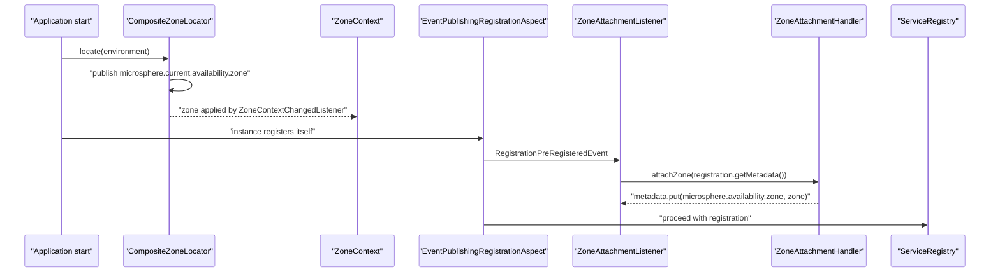

English version: [English](../microsphere-multiactive-spring-cloud.md)

# microsphere-multiactive-spring-cloud

## 概述

`microsphere-multiactive-spring-cloud` 是本文档线中层次最高、也是多数情况下你应该选择的集成模块。它把多活闭环的
两个半边都补齐了：

1. **广播** —— 当你的实例向注册中心注册时，它的可用区被写入注册元数据
   （`ZoneAttachmentListener` → `ZoneAttachmentHandler`）。
2. **路由** —— 当 Spring Cloud LoadBalancer 解析某服务的候选实例时，列表会被优先收敛到同区实例
   （`ZonePreferenceServiceInstanceListSupplier` → `ZonePreferenceFilter`），并应用 commons 层的那些安全阀。

它直接构建在 [Spring Boot 模块](microsphere-multiactive-spring-boot.md)之上，因此只加这一个模块就能同时获得
`zoneContext` 与 `zoneLocator`。

包名：`io.microsphere.multiple.active.zone.spring.cloud`、`.cloud.autoconfigure`、`.cloud.event`、
`.cloud.loadbalancer`。

## Maven 坐标

```xml
<dependency>
    <groupId>io.github.microsphere-projects</groupId>
    <artifactId>microsphere-multiactive-spring-cloud</artifactId>
    <version>0.2.14-SNAPSHOT</version>
</dependency>
```

- `groupId`：`io.github.microsphere-projects`
- `artifactId`：`microsphere-multiactive-spring-cloud`
- `version`：`${revision}` → `0.2.14-SNAPSHOT`
- `packaging`：`jar`，`<name>`：`Microsphere :: Multi-Active :: Spring Cloud`

> 与 Boot 模块同理：BOM 预留的坐标 `microsphere-multiactive-spring-cloud-starter` **并非**本分支发布的内容，
> 而 `microsphere-multiactive-spring-cloud` 也不在 BOM 的版本管理范围内。请显式写出版本。

## 版本信息

| 项目 | 值 | 验证位置 |
|------|-------|-------------|
| 文档线 / 分支 | `current` / `release` | 本套文档 |
| 构件版本 | `0.2.14-SNAPSHOT` | 根 `pom.xml` 的 `<revision>` |
| JDK | 17 及以上（CI 矩阵：17、21、25） | `.github/workflows/maven-build.yml` |
| 依赖的其他 Multi-Active 模块 | `microsphere-multiactive-spring-boot` —— **compile 作用域，非可选**（→ `spring` → `commons`） | `microsphere-multiactive-spring-cloud/pom.xml` |
| 可选依赖 | `microsphere-spring-cloud-commons`、`spring-boot-starter`、`spring-boot-starter-actuator`、`spring-boot-starter-web`、`spring-boot-configuration-processor`、`spring-boot-autoconfigure-processor`、`spring-cloud-commons`、`spring-cloud-context`、`spring-cloud-loadbalancer`、`microsphere-annotation-processor` | `microsphere-multiactive-spring-cloud/pom.xml` |
| 测试依赖 | `junit-jupiter`、`spring-boot-starter-test`、`microsphere-spring-boot-test`、`logback-classic` | `microsphere-multiactive-spring-cloud/pom.xml` |
| Spring Boot / Spring Cloud 版本 | 此处未锁定；由 `microsphere-multiactive-parent` 引入的 `microsphere-spring-cloud-dependencies:0.2.26` 管理 | `microsphere-multiactive-parent/pom.xml` |
| Spring Cloud 发布列车兼容范围 | `2022.0.x` – `2025.0.x` | 根 `README.md`、CI profile `spring-cloud-2022` … `spring-cloud-2025` |
| Netflix / AWS | 本模块未引用（方向恰好相反：`aws` 与 `netflix` 依赖*本*模块，且是可选依赖） | `microsphere-multiactive-aws/pom.xml`、`microsphere-multiactive-netflix/pom.xml` |

`microsphere-spring-cloud-commons` 提供本模块所响应的那些注册事件与切面类型
（`RegistrationPreRegisteredEvent`、`EventPublishingRegistrationAspect`、`ConditionalOnAutoServiceRegistrationEnabled`、
`ServiceRegistryConstants`）。它被声明为可选，因此当它缺失时**注册阶段的可用区写入会自动静默关闭** —— 保证这一点的
正是 `ZoneCloudAutoConfiguration` 上的 `@ConditionalOnClass`。

## 自动配置元数据

`META-INF/spring/org.springframework.boot.autoconfigure.AutoConfiguration.imports`：

```
io.microsphere.multiple.active.zone.spring.cloud.autoconfigure.ZoneCloudAutoConfiguration
io.microsphere.multiple.active.zone.spring.cloud.loadbalancer.CustomizedLoadBalancerAutoConfiguration
```

`META-INF/config/default/features.yaml` 把本模块的类声明为一个命名特性集合（供 Microsphere Spring Cloud
特性机制使用）：

```yaml
microsphere:
  spring:
    cloud:
      features:
        named:
          microsphere-multiactive-commons:
            - io.microsphere.multiple.active.zone.ZoneAttachmentHandler
            - io.microsphere.multiple.active.zone.ZoneContext
            - io.microsphere.multiple.active.zone.ZonePreferenceFilter
            - io.microsphere.multiple.active.zone.ZoneResolver
          microsphere-multiactive-spring:
            - io.microsphere.multiple.active.zone.spring.ZoneLocator
            - io.microsphere.multiple.active.zone.spring.event.ZoneContextChangedListener
          microsphere-multiactive-spring-cloud:
            - WebEndpointApplicationContextInitializer=io.microsphere.spring.cloud.gateway.server.webmvc.context.WebEndpointApplicationContextInitializer
```

## API 参考

### `ZoneCloudAutoConfiguration`

```java
@Configuration(proxyBeanMethods = false)
@ConditionalOnAvailabilityZoneAvailable
@ConditionalOnAutoServiceRegistrationEnabled
@ConditionalOnClass(name = {
        "org.aspectj.lang.annotation.Aspect",
        "io.microsphere.spring.cloud.client.service.registry.event.RegistrationPreRegisteredEvent",
        REGISTRATION_CLASS_NAME
})
@ConditionalOnBean(ZoneContext.class)
@AutoConfigureAfter(value = {ZoneAutoConfiguration.class},
        name = {"org.springframework.cloud.netflix.eureka.EurekaClientAutoConfiguration",
                "io.microsphere.spring.cloud.client.service.registry.autoconfigure.ServiceRegistryAutoConfiguration"})
@Import(value = {ZoneAttachmentHandler.class})
public class ZoneCloudAutoConfiguration {

    @Bean
    @ConditionalOnBean(type = "io.microsphere.spring.cloud.client.service.registry.aspect.EventPublishingRegistrationAspect")
    @ConditionalOnMissingBean
    public ZoneAttachmentListener zoneAttachmentListener()
}
```

全部条件相与：

| 条件 | 含义 |
|-----------|---------|
| `@ConditionalOnAvailabilityZoneAvailable` | `ZoneContext` + `ZoneLocator` 类存在**且** `microsphere.availability.zone.enabled != false` |
| `@ConditionalOnAutoServiceRegistrationEnabled` | `spring.cloud.service-registry.auto-registration.enabled` 不为 `false` |
| `@ConditionalOnClass(name = ...)` | AspectJ weaver 存在、Microsphere 注册事件存在、服务注册的 `Registration` 类型存在（`REGISTRATION_CLASS_NAME` 是 `microsphere-spring-cloud-commons` 中的常量，其字面值不在本仓库内） |
| `@ConditionalOnBean(ZoneContext.class)` | Boot 自动配置已经执行过 |
| `@AutoConfigureAfter(...)` | 顺序：在 `ZoneAutoConfiguration` 之后、在 Eureka client 之后、在 Microsphere 的 `ServiceRegistryAutoConfiguration` 之后 |
| bean 方法上的 `@ConditionalOnBean(type = "...EventPublishingRegistrationAspect")` | 只有确实有东西发布“注册前事件”时才创建监听器 |

`@Import(ZoneAttachmentHandler.class)` 把 handler 注册为 bean（它只有一个以 `ZoneContext` 为参数的构造器，
由 Spring 自动装配）。

### `ZoneAttachmentListener`

```java
public class ZoneAttachmentListener implements ApplicationListener<RegistrationPreRegisteredEvent>, ApplicationContextAware
```

每收到一个 `RegistrationPreRegisteredEvent`，它取 `event.getRegistration().getMetadata()`，交给
`ZoneAttachmentHandler` bean，由后者往该 map 中放入 `microsphere.availability.zone=<你的可用区>` —— 就在实例被注册之前。
由于 `attachZone` 会吞掉写入失败，不可变的元数据 map 也不可能打断注册流程。



### `CloudServerZoneResolver`

```java
public class CloudServerZoneResolver implements ZoneResolver<ServiceInstance> {
    public static final CloudServerZoneResolver INSTANCE = new CloudServerZoneResolver();
    public String resolve(ServiceInstance serviceInstance)
}
```

从 Spring Cloud `ServiceInstance` 的元数据 map 中读取 `microsphere.availability.zone`；当元数据 map 为 `null`
时返回 `null`。之所以提供 `INSTANCE` 常量，是为了让适配器（Netflix 模块的 `DiscoveryClientServer`）无需分配即可复用。

### 可用区感知的 Spring Cloud LoadBalancer

`CustomizedLoadBalancerAutoConfiguration`：

```java
@Configuration(proxyBeanMethods = false)
@ConditionalOnProperty(value = "microsphere.spring.cloud.loadbalancer.customized", havingValue = "true")
@ConditionalOnClass(name = {"org.springframework.cloud.loadbalancer.annotation.LoadBalancerClient"})
@LoadBalancerClients(defaultConfiguration = CustomizedLoadBalancerClientConfiguration.class)
public class CustomizedLoadBalancerAutoConfiguration {
}
```

**除非 `microsphere.spring.cloud.loadbalancer.customized=true`，否则它是关闭的**（`havingValue = "true"`，且没有
`matchIfMissing`）。一旦开启，它会把 `CustomizedLoadBalancerClientConfiguration` 注册为*所有*负载均衡客户端的
*默认*配置。

`CustomizedLoadBalancerClientConfiguration`：

| 成员 | 条件 | 结果 |
|--------|-----------|--------|
| `zonePreferenceFilter(ZoneContext)` | 总是 | `new ZonePreferenceFilter<>(zoneContext, new CloudServerZoneResolver())` |
| `ReactiveConfiguration.optimizedZonePreferenceDiscoveryClientServiceInstanceListSupplier(...)` | `@ConditionalOnReactiveDiscoveryEnabled`、`@Order(193827465)`、需要存在 `DiscoveryClient` bean、`@ConditionalOnMissingBean`，并通过 `OptimizedZoneConfigurationCondition` | 以 `ServiceInstanceListSupplier.builder().withDiscoveryClient().withCaching().with(...)` 构建，包装进可用区 supplier |
| `BlockingConfiguration.optimizedZonePreferenceServiceInstanceListSupplier(...)` | `@ConditionalOnBlockingDiscoveryEnabled`、`@Order(193827466)`、其余条件同上 | 同样的链，改用 `withBlockingDiscoveryClient()` |
| `OptimizedZoneConfigurationCondition` | —— | `LoadBalancerEnvironmentPropertyUtils.equalToForClientOrDefault(environment, "configurations", "optimized-zone-preference")` |

最后一行是按客户端粒度的开关：只有当某个负载均衡客户端的 Spring Cloud LoadBalancer `configurations` 取值等于
`optimized-zone-preference` 时，才会安装该 supplier。属性前缀本身属于 Spring Cloud LoadBalancer
（`spring.cloud.loadbalancer.configurations...`），确切 key 由 `LoadBalancerEnvironmentPropertyUtils`
解析 —— 按客户端名或走共享默认值。

`ZonePreferenceServiceInstanceListSupplier`：

```java
public class ZonePreferenceServiceInstanceListSupplier extends DelegatingServiceInstanceListSupplier {
    public ZonePreferenceServiceInstanceListSupplier(ServiceInstanceListSupplier delegate,
                                                     ZonePreferenceFilter<ServiceInstance> zonePreferenceFilter)
    public Flux<List<ServiceInstance>> get()   // delegate.get().map(zonePreferenceFilter::filter)
}
```

它是 Spring Cloud 自带 `ZonePreferenceServiceInstanceListSupplier` 的直接替换品：保留原有委托链（discovery +
caching），并对每一次发射出的列表应用 commons 的 `ZonePreferenceFilter` —— 就绪百分比与同区最小数量这两道阈值正是在
这里生效。

## 配置属性

| 属性 | 默认值 | 效果 |
|----------|---------|--------|
| `microsphere.availability.zone.enabled` | `true` | 关闭两个自动配置 |
| `microsphere.availability.zone` | `defaultZone` | 写入注册元数据的可用区，也是过滤时比对的可用区 |
| `microsphere.availability.zone.preference.enabled` | `false` | 负载均衡收窄必须为 `true` |
| `microsphere.availability.zone.preference.upstream.*` | 见 commons | 过滤器的阈值 |
| `microsphere.spring.cloud.loadbalancer.customized` | *缺省即关闭* | 注册定制化的默认负载均衡客户端配置 |
| `spring.cloud.loadbalancer.configurations...` | —— | 必须等于 `optimized-zone-preference` 才会安装该 supplier 的 Spring Cloud LoadBalancer 属性 |
| `spring.cloud.service-registry.auto-registration.enabled` | `true` | 为 `false` 时完全跳过 `ZoneCloudAutoConfiguration` |
| `microsphere.spring.cloud.service-registry.auto-registration.simple.enabled` | —— | 集成测试用它开启简单的内存自动注册 |

## 示例

### 自动配置的期望行为（`ZoneCloudAutoConfigurationTest`）

```java
@SpringBootTest(
        classes = {
                ZoneContext.class,
                EventPublishingRegistrationAspect.class,
                ZoneCloudAutoConfigurationTest.class
        },
        webEnvironment = NONE
)
class ZoneCloudAutoConfigurationTest extends AutoConfigurationTest<ZoneCloudAutoConfiguration> {

    @Override
    protected void configureAutoConfiguredClasses(Set<Class<?>> autoConfiguredClasses) {
        autoConfiguredClasses.add(ZoneAttachmentHandler.class);
        autoConfiguredClasses.add(ZoneAttachmentListener.class);
    }

    @Override
    protected void configureGlobalDisabledPropertyValues(Set<String> globalDisabledPropertyValues) {
        globalDisabledPropertyValues.add("microsphere.availability.zone.enabled=false");
        globalDisabledPropertyValues.add("spring.cloud.service-registry.auto-registration.enabled=false");
    }

    @Override
    protected void configureGlobalMissingClasses(Set<Class<?>> globalMissingClasses) {
        globalMissingClasses.add(ZoneLocator.class);
        globalMissingClasses.add(Aspect.class);
        globalMissingClasses.add(RegistrationPreRegisteredEvent.class);
        globalMissingClasses.add(Registration.class);
    }
}
```

当作规格说明来读：只要 `microsphere.availability.zone.enabled` 不为 `false`、自动注册开启，并且 AspectJ、
Microsphere 注册事件、Spring Cloud 的 `Registration` 类型都在 classpath 上，`ZoneAttachmentHandler` 与
`ZoneAttachmentListener` 就必须存在。移除其中任意一项，bean 就随之消失。

### 端到端装配（`ZoneCloudAutoConfigurationIntegrationTest`）

```java
@SpringBootTest(
        classes = {
                InMemoryServiceRegistry.class,
                ZoneCloudAutoConfigurationIntegrationTest.class
        },
        webEnvironment = NONE,
        properties = {
                "server.port=8080",
                "spring.application.name=test-service",
                "microsphere.spring.cloud.service-registry.auto-registration.simple.enabled=true"
        }
)
@EnableAutoConfiguration
@EnableConfigurationProperties(value = {
        ServerProperties.class
})
public class ZoneCloudAutoConfigurationIntegrationTest {

    @Autowired
    private Registration registration;
    @Autowired
    private ServiceRegistry<Registration> serviceRegistry;
    @Autowired
    private ZoneContext zoneContext;
    @Autowired
    private CompositeZoneLocator compositeZoneLocator;
    @Autowired
    private ZoneAttachmentHandler zoneAttachmentHandler;
    @Autowired
    private ZoneAttachmentListener zoneAttachmentListener;

    @Test
    void test() {
        assertNotNull(zoneContext);
    }
}
```

每个 `@Autowired` 字段都是对本模块所产出的默认 Boot 上下文的一条断言：可用区 bean、定位器组合、attachment handler
与监听器，与 `Registration` 和 `ServiceRegistry<Registration>` 同时共存。

### 开启同区优先负载均衡

```yaml
microsphere:
  availability:
    zone: zone-a
    preference:
      enabled: true
  spring:
    cloud:
      loadbalancer:
        customized: true

spring:
  cloud:
    loadbalancer:
      configurations: optimized-zone-preference
```

### 为自己的列表复用解析器

```java
ZonePreferenceFilter<ServiceInstance> filter =
        new ZonePreferenceFilter<>(ZoneContext.get(), CloudServerZoneResolver.INSTANCE);

List<ServiceInstance> sameZone = filter.filter(discoveryClient.getInstances("order-service"));
```

## 如何集成

```xml
<dependency>
    <groupId>io.github.microsphere-projects</groupId>
    <artifactId>microsphere-multiactive-spring-cloud</artifactId>
    <version>0.2.14-SNAPSHOT</version>
</dependency>
```

最小步骤：

1. 添加依赖；`spring-boot`、`spring`、`commons` 随之而来。
2. 让 `spring-cloud-commons`、`spring-cloud-context` 保持在 classpath 上（要做路由还需要
   `spring-cloud-loadbalancer`）—— 典型网关/服务中 Spring Cloud 已带入前两者。
3. 若希望在服务注册时写入可用区，请保留 `microsphere-spring-cloud-commons`。
4. 设置 `microsphere.availability.zone` 并安装一个平台定位器 —— 见
   [microsphere-multiactive-aws.md](microsphere-multiactive-aws.md)。
5. 若希望 Spring Cloud LoadBalancer 优先选择同区实例，请设置
   `microsphere.availability.zone.preference.enabled=true`，再加上
   `microsphere.spring.cloud.loadbalancer.customized=true` 与 `configurations` 开关。

## 相关文档

- [用户指南索引](README.md)
- [microsphere-multiactive-spring-boot.md](microsphere-multiactive-spring-boot.md) —— 本模块构建于其上
- [microsphere-multiactive-commons.md](microsphere-multiactive-commons.md) —— 过滤算法与阈值
- [microsphere-multiactive-netflix.md](microsphere-multiactive-netflix.md) —— 本模块对应的 Ribbon/Eureka 版本
- 根 [README](../../../../README.md) 与[发布说明](../../../../release-notes.md)
- 开发者指南：[../../developer-guide/zh/microsphere-multiactive-spring-cloud.md](../../developer-guide/zh/microsphere-multiactive-spring-cloud.md)

## English

English version: [English](../microsphere-multiactive-spring-cloud.md)
